# All Career

##  See when a job was posted and what it requires

Job openings are spread across portals, employer career pages, and community posts. On LinkedIn and Indeed, the exact years of experience can be inside the description. All Career brings listings into one search and puts the posting date, location, and experience requirement on the job card when the source provides them. [LinkedIn job search guide](https://www.linkedin.com/help/linkedin/answer/a507441/filter-and-sort-job-search-results) · [Indeed job search guide](https://www.indeed.com/career-advice/finding-a-job/how-does-indeed-work)

##  From discovery to application

1. **Find jobs across sources.** All Career collects openings from Naukri, LinkedIn, Indeed, other job boards, employer career sites, public Telegram posts, and hiring flyers throughout the day.
2. **Narrow the list.** Search by keyword or company. Filter by source, city, time posted, role, skills, experience, and job category. Walk-ins can also be filtered by interview date.
3. **Open the original listing.** Review the full requirements and apply through the listing. For walk-ins, use the original flyer or contact details when available.

##  Try your first search

- **New to work?** Choose a city and select **0 years** to find listings that accept zero years of experience, including ranges such as **0–2 years**. Select **Exactly 0 years only** for the narrower search.
- **Looking for a walk-in?** Open **Walk-in Interview** and pick an interview date and a city. If few listings appear, clear the experience filter to see listings where the employer hasn’t specified years.
- **Checking when a job appeared?** Use **Posted Date** to narrow the results. Open the original listing to confirm the role is still accepting applications.

##  Save or share a search

All Jobs updates the URL as you change filters. Copy it to bookmark the search or send someone the same selection. Results reflect the current catalog when they open the link.

##  Explore All Career

### 

Compare recent openings across sources. Browse software, nontechnical, and fresher roles.

### 

Find upcoming interviews by date and city. The interview date appears separately from the posting date.

### 

Browse openings from major employers and follow links to their recruiting pages.

### 

Find employers by name or location and open their official career sites.

### 

Practice company-specific questions, the Top 150, or the full catalog. Explore topics, difficulty levels, and supported languages.

On desktop, the optional Auto Apply extension can assist with supported applications after you review the selected jobs.

All Career is a personal and educational project. Confirm current dates and eligibility on the original listing. [MIT License](./LICENSE)
